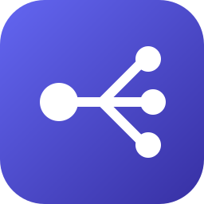

<p align="center">
  
</p>

<h1 align="center">dotagents</h1>

<p align="center">
  <b>Portable agent instructions; one AGENTS.md and a shared skill library, symlinked into every coding agent you use.</b>
</p>

<p align="center">
  A single install script links the same guidelines and skills into Claude Code, OpenAI Codex, Gemini / Antigravity, OpenCode and the Agent Skills standard directory, so every agent works the same way.<br>
  <i>By Brian Nunez.</i>
</p>

<p align="center">
  
  
  
  <br>
  <a href="https://www.linkedin.com/in/brianjnunez/"></a>
</p>

<p align="center">
  <a href="#quick-start"></a>
</p>

<p align="center">
  <a href="#quick-start"><b>Quick start</b></a> ·
  <a href="#skills">Skills</a> ·
  <a href="#supported-agents">Supported agents</a> ·
  <a href="src/AGENTS.md">Agent guidelines</a>
</p>

<br>

> [!WARNING]
> **The installer replaces existing global instruction files.** `install.sh` uses `ln -sf`, so a real `~/.claude/CLAUDE.md`, `~/.codex/AGENTS.md`, `~/.gemini/config/AGENTS.md`, `~/.config/opencode/AGENTS.md` or `~/.agents/AGENTS.md` is overwritten by a symlink. Back up any of those files you want to keep before you run it.

<p align="center">
  <a href="#why-dotagents">Why dotagents</a> ·
  <a href="#skills">Skills</a> ·
  <a href="#supported-agents">Supported agents</a> ·
  <a href="#quick-start">Quick start</a> ·
  <a href="#adding-a-skill">Adding a skill</a> ·
  <a href="#repository-layout">Repository layout</a>
</p>

## Why dotagents

- **One source.** [`src/AGENTS.md`](src/AGENTS.md) holds the universal guidelines (communication, decision ownership, planning, safety and verification) and every supported agent reads that same file.
- **Live.** Everything is symlinked, not copied. Edit a file in this repository and every agent sees the change on its next session, with no reinstall.
- **Non-destructive for skills.** Skills are linked one directory at a time, so skills that other tools install into the same `skills/` directory stay in place. The installer stops instead of overwriting a skill directory that is not a symlink.
- **Opt-in skills.** Skills that should only run on request set `disable-model-invocation: true`, so the agent does not load them on its own.

## Skills

Each skill is a directory under [`src/skills/`](src/skills) with a `SKILL.md` file. Auto skills can be loaded by the agent when the task matches the description; manual skills run only when you invoke them by name (for example `/readme-writing` in Claude Code).

| Skill | Invocation | Description |
| ----- | ---------- | ----------- |
| **[Docker Patterns](src/skills/docker-patterns/SKILL.md)** | Auto | Docker and Docker Compose conventions: image selection, multi-stage builds, health checks, resource limits and file organization. |
| **[Programming](src/skills/programming/SKILL.md)** | Auto | Tech stack, package managers and coding standards for software engineering tasks. |
| **[README Writing](src/skills/readme-writing/SKILL.md)** | Auto | Writes a README in a fixed house style, then renders and checks it visually with the bundled [scripts](src/skills/readme-writing/scripts). |
| **[Decommissioning](src/skills/decommissioning/SKILL.md)** | Manual | Procedures for tearing down infrastructure, services, databases and networks. |
| **[Infrastructure and Networking](src/skills/infrastructure-and-networking/SKILL.md)** | Manual | Guidelines for deploying, managing and securing servers, networks and services. |
| **[Messaging Architecture](src/skills/messaging-architecture/SKILL.md)** | Manual | Shapes an audience-first message before writing slides, diagrams, a talk track or a document. |
| **[Project Bootstrapping](src/skills/project-bootstrapping/SKILL.md)** | Manual | How new projects are scaffolded: Go API templates, the BKit library ecosystem, JS/TS setup and build tooling. |
| **[Project Foundations](src/skills/project-foundations/SKILL.md)** | Manual | Interviews you, then lays or completes a repository's language-agnostic foundations: AGENTS.md, MADR decision records, LICENSE, .gitignore, .gitattributes, CODEOWNERS, project skills, optional APM and the README. |
| **[Relational Row Claims](src/skills/relational-row-claims/SKILL.md)** | Manual | Claim columns, indexing and locking syntax for workers that claim rows from a relational table. |

## Supported agents

`install.sh` creates these links. All paths are relative to your home directory.

| Agent | Guidelines link | Skills directory |
| ----- | --------------- | ---------------- |
| **Claude Code** | `~/.claude/CLAUDE.md` | `~/.claude/skills/` |
| OpenAI Codex CLI | `~/.codex/AGENTS.md` | `~/.codex/skills/` |
| Gemini / Antigravity | `~/.gemini/config/AGENTS.md` | `~/.gemini/config/skills/` |
| OpenCode | `~/.config/opencode/AGENTS.md` | Not linked |
| Agent Skills standard | `~/.agents/AGENTS.md` | `~/.agents/skills/` |

Claude Code reads `CLAUDE.md` instead of `AGENTS.md`, so its link has a different name but points to the same file.

## Quick start

```bash
git clone https://github.com/brian-nunez/dotagents.git   # clone the repository
cd dotagents                                              # enter it
./install.sh                                              # link AGENTS.md and skills into every agent
```

The links point to the absolute path of the clone, so keep the repository where you cloned it. If you move it, run `./install.sh` again from the new location.

Run the script again at any time; it is safe to repeat. It also migrates older installs: a `skills/` directory that was itself a symlink into this repository is replaced with a real directory of per-skill links.

If a skill directory with the same name already exists and is not a symlink, the script prints `Cannot link <skill>: <path> already exists and is not a symlink.` and exits. Targets processed before that point stay linked. Move or remove the conflicting directory, then run the script again.

## Adding a skill

Create a directory under `src/skills/` that contains a `SKILL.md` with `name` and `description` front matter. For example, the front matter of [`messaging-architecture`](src/skills/messaging-architecture/SKILL.md):

```markdown
---
name: messaging-architecture
description: Shape an audience-first message before writing its slides, diagrams, talk track, or document.
disable-model-invocation: true
---
```

Leave out `disable-model-invocation` if the agent may load the skill on its own. Then run `./install.sh` so the new directory is linked into each agent; edits to existing skills need no reinstall. Directories without a `SKILL.md` are skipped.

## Repository layout

```text
dotagents/
├── install.sh           # links AGENTS.md and each skill into every agent
├── docs/brand/          # project icon
└── src/
    ├── AGENTS.md        # universal agent guidelines
    └── skills/
        └── <skill>/
            ├── SKILL.md # skill instructions and front matter
            └── ...      # optional references/ and scripts/
```
